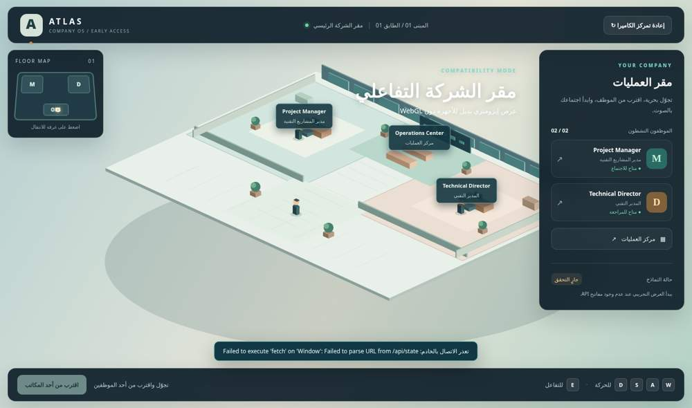
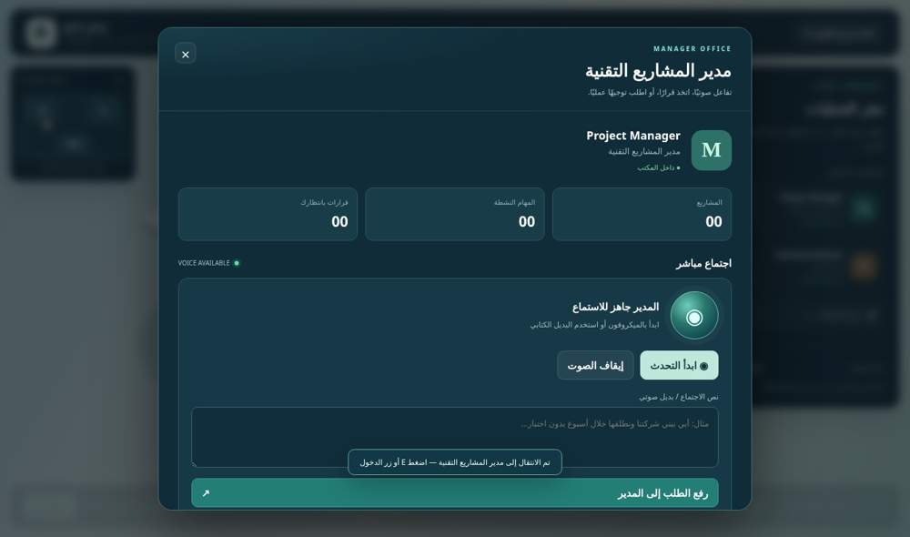
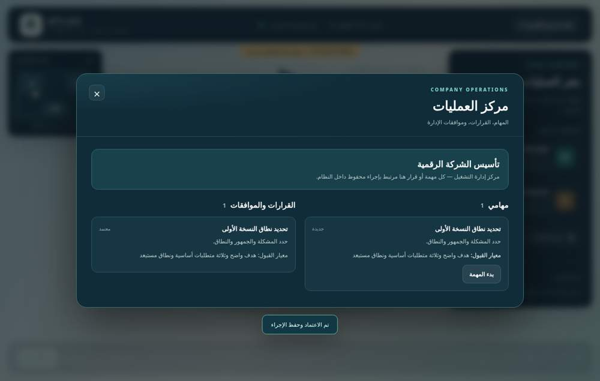
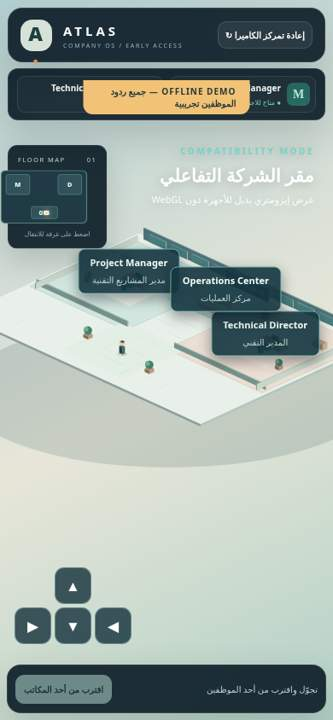

# ATLAS — Company OS

An **Arabic-first 3D browser office** where a human CEO walks between rooms and directs AI employees.
The staff are a Project Manager, a Technical Director, a Software Developer and a QA Engineer. They plan
projects, debate decisions, change code in an isolated sandbox repository, test it, and ask the CEO for approval.

> **Status:** MVP (COS-101 → COS-107) and COS-108 (immersive office) merged into `main`. It runs locally. LIVE AI needs your own API keys;
> without them every employee runs in clearly labelled **DEMO** mode at $0.
> Start at the **[Project Hub](docs/PROJECT-HUB.md)**.

## Screenshots

| 3D office | Manager office |
|---|---|
|  |  |

| CEO workspace | Mobile |
|---|---|
|  |  |

## Run locally

Requires **Node.js ≥ 22.13** (uses the built-in `node:sqlite`).

```bash
npm ci
npm start            # http://127.0.0.1:3099 — first visit creates the local CEO account
```

The server binds to `127.0.0.1` and refuses other hosts unless you explicitly opt in (see
[DEPLOYMENT.md](docs/DEPLOYMENT.md)). Data lives in the git-ignored `data/` folder.

### Modes
| Mode | When | What is real |
|---|---|---|
| **DEMO** | no API key for that employee's provider | Replies, plans and code patches are **pre-written**. File edits, test runs and git commits in the sandbox are **real** |
| **LIVE** | `GROQ_API_KEY` / `DEEPSEEK_API_KEY` set in `.env` | Real model calls (paid), with budgets and cost tracking |
| **STATIC DEMO** | GitHub Pages build (`npm run build:demo`) | Nothing. A browser-only simulation, labelled as such |

## Controls
- Move with `W A S D` or the arrow keys; touch buttons on mobile.
- Interact with `E` when you are inside an office and can see the employee. Walls block both movement and
  interaction.
- `C` toggles the free camera (drag to orbit, wheel or pinch to zoom). `Esc` closes panels.
- The mini-map shows live employee status; click a room to travel there.
- Talk with push-to-talk (browser speech, with consent first) or type.

## The workflow
1. Ask the **Project Manager** for a project. They challenge unrealistic requests and write a plan with tasks
   and acceptance criteria.
2. Important technical decisions are escalated to the **Technical Director** for an evidence-based review.
3. You approve the plan and the decisions in the **CEO office**.
4. The **Developer** implements the work in the sandbox repo: files, tests, a commit, and a PR (local, or GitHub
   if configured).
5. **QA** writes independent tests. The system re-runs them, and failures send the work back for rework.
6. You review the diff and QA evidence, then approve the merge, and evaluate employees. Costs, budgets, the audit
   log and an emergency stop are all in the CEO workspace.

## Quality
```bash
npm run lint && npm test && npx playwright test
```
Results: [docs/TEST-RESULTS.md](docs/TEST-RESULTS.md).

## Repository map
| Path | Contents |
|---|---|
| `public/` | Browser app (ES modules, no bundler): `js/core` maths/collision, `js/world` world data and renderers, `js/game` player/camera/input, `js/ui` panels, `js/net` API client and static demo backend, `js/voice` |
| `server/` | HTTP server, auth, SQLite repo and migrations, AI employees (`agents/`), sandbox tools (`tools/`) |
| `supabase/` | Postgres + RLS schema for a future cloud deployment (untested) |
| `tests/` | node:test suites and Playwright e2e |
| `docs/` | Hub, status, roadmap, architecture, API, DB, security, costs, deployment, handover |

## Security and privacy
Read [SECURITY.md](SECURITY.md). This repository is **public**: do not commit keys, `.env`, `data/`,
transcripts or personal data. No license is granted yet.
