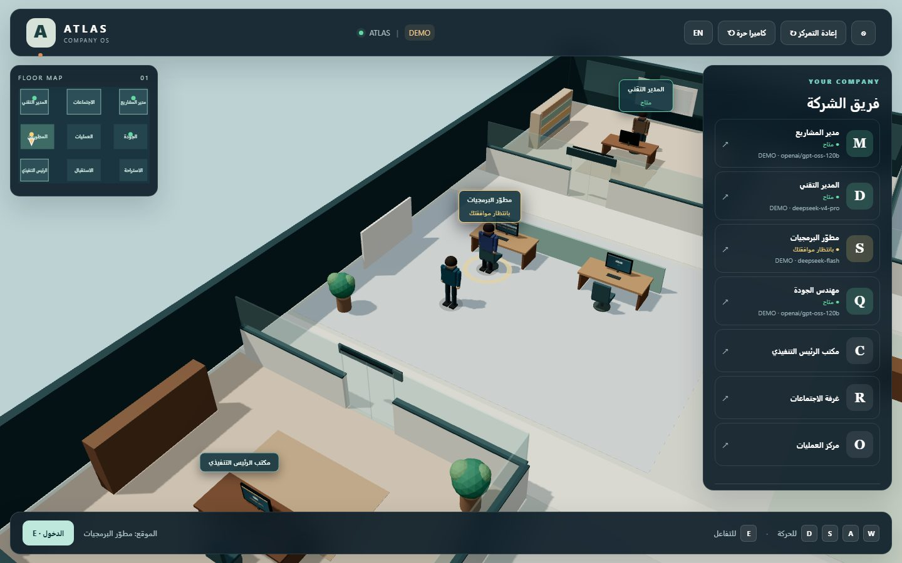
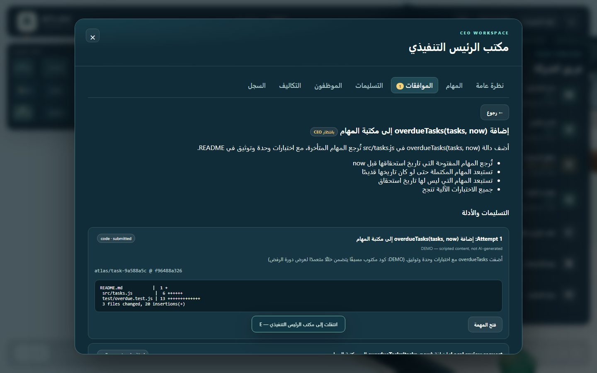
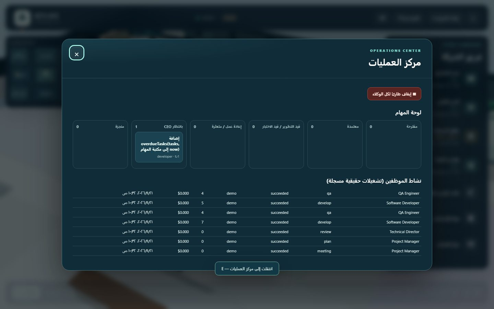
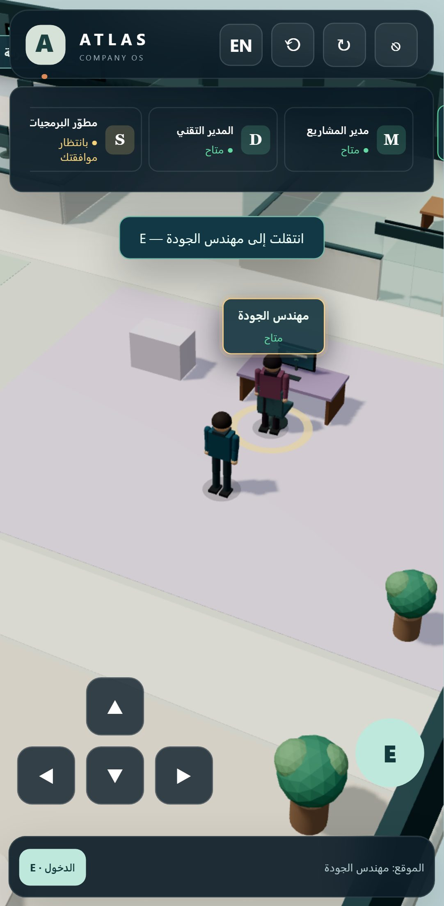

# COS-107 — Immersive office, live status, voice, CEO workspace

## Scope
Turn the prototype into an explorable 3D company HQ driven by **real** backend state, and put the whole CEO
workflow inside the game. This is not a GTA-style game: there is no combat or vehicles, and only the office
and its people.

## Design decisions
- **Three.js r187 (MIT)** is vendored from `node_modules` and served same-origin, so the CSP stays
  `script-src 'self'` with no CDN. The scene is built from `world-data.js` primitives, so rendering and
  collision cannot drift apart. The Canvas2D renderer stays as the fallback.
- **Characters are procedural** (`humanoid.js`). They are original code with no downloaded models, so there is
  no licensing risk. The walk cycle advances with distance actually travelled. NPC poses come from the real
  employee status: typing only while `executing`, thinking while `planning`/`reviewing`, talking while
  `in_meeting`, and head down while `blocked`.
- **Monitors** are CanvasTextures redrawn only when their owner's state changes: employee status, task board
  counts, last meeting, pending CEO approvals.
- **Doors** are glass panels that slide open as you approach. They are visual only; the doorway gap is what
  collision uses.
- **The UI** is one store polling `/api/state`: every 1.5 s while jobs run, every 8 s when idle. Panels
  re-render only when their HTML changes. All model text goes through `esc()`, and links render only for
  `https://github.com/...`.
- **Voice** uses the browser Web Speech API with push-to-talk, stop/interrupt, and a consent notice before the
  first use. Recognition in Chrome/Edge uses the vendor's cloud, and the notice says so. Only text is stored.
  Firefox falls back to typing.

## Rooms
- CEO office: the CEO workspace.
- Project Manager office and Technical Director office: walled, with doors.
- Developer workstations and the QA lab.
- Meeting room: transcripts of all meetings.
- Operations center: kanban, activity and the emergency stop.
- Reception (spawn) and the lounge.

## Evidence
| Office (developer awaiting CEO approval) | CEO workspace: task evidence |
|---|---|
|  |  |

| Operations center | Mobile |
|---|---|
|  |  |

Tests: see [TEST-RESULTS.md](../TEST-RESULTS.md).
- `npm test`: 40/40.
- Playwright: 28 passed in Chromium, Firefox, WebKit and mobile, including the full acceptance flow through the
  UI.
- The renderer was Three.js in all three engines.

## Limitations
- The characters are simple, low-poly shapes.
- Speech recognition was not tested with a real microphone.
- The labels above characters are DOM overlays, updated at 10 Hz.
- See [BLOCKERS.md](../BLOCKERS.md).
