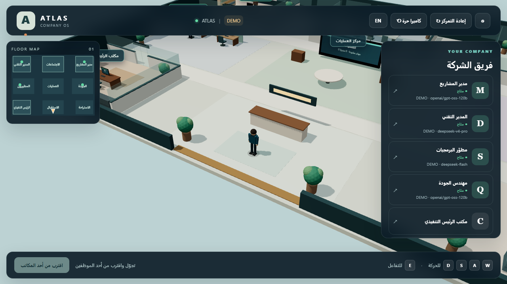
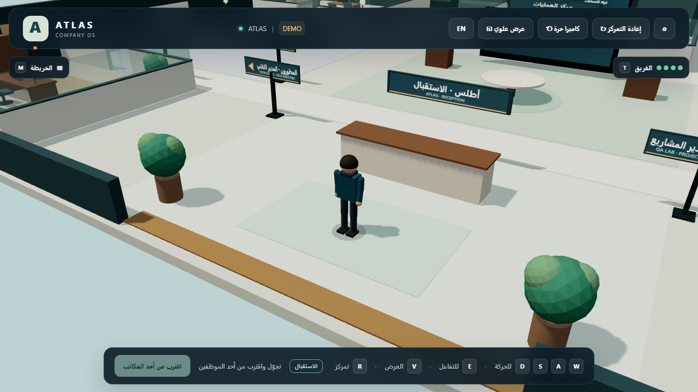
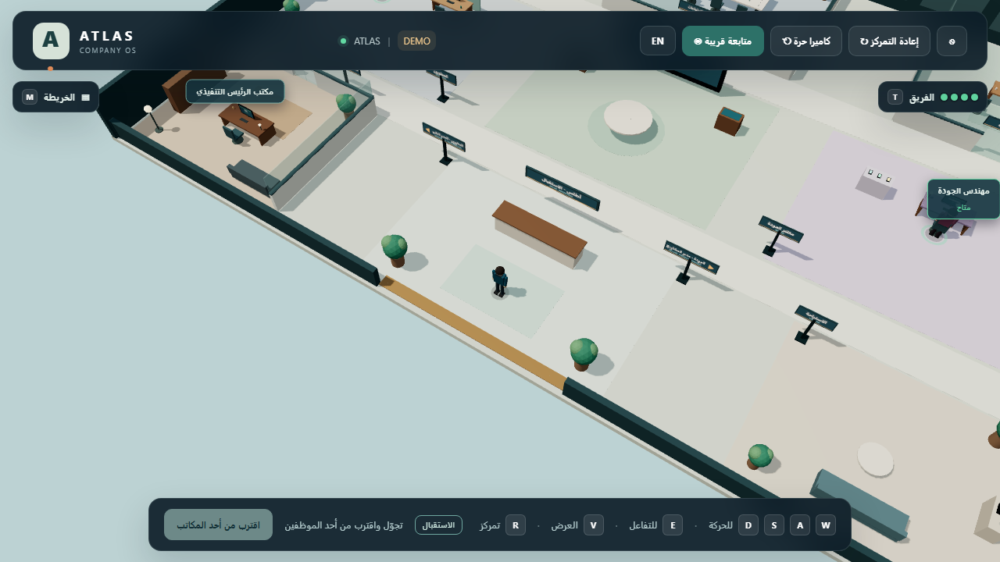
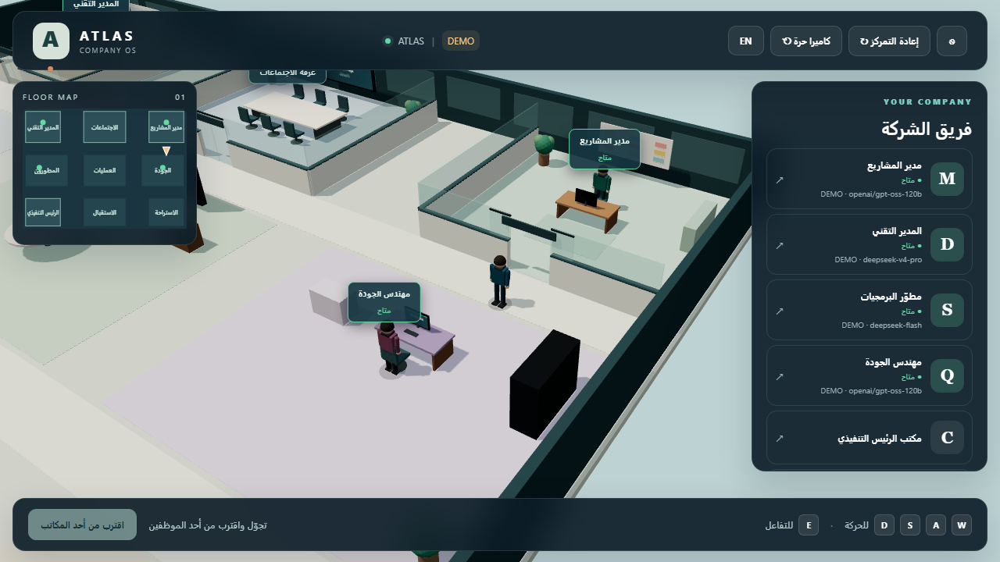
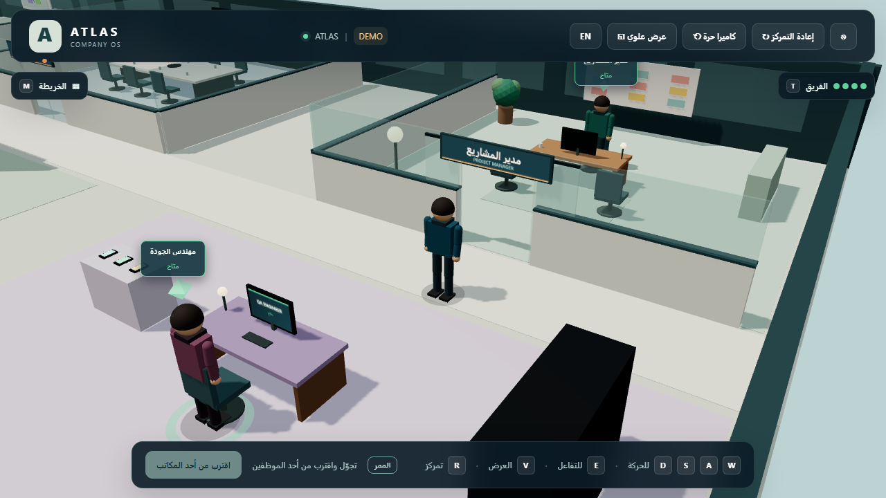
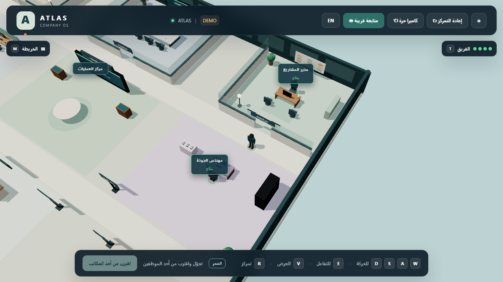
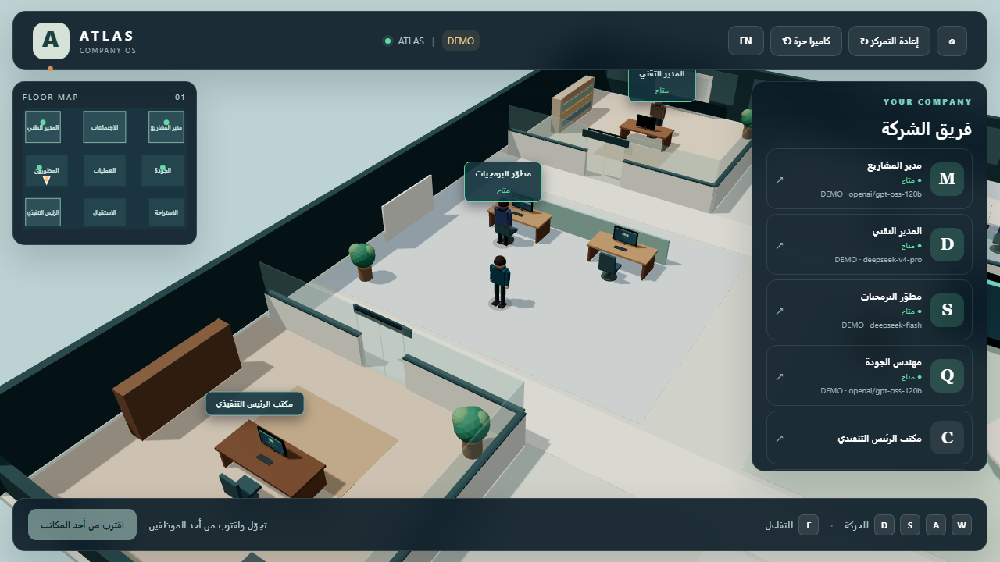
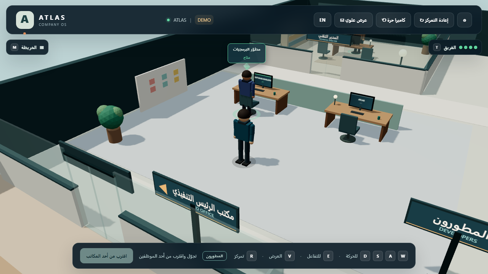
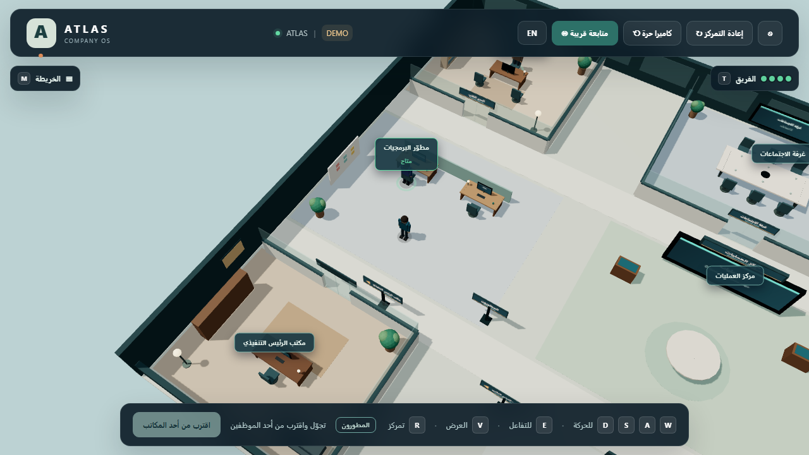

# COS-108: Immersive office experience (report)

**Issue:** #8 · **Branch:** `cos-108-immersive-office-experience` · **Date:** 2026-11-21 · **Status:** PR open, awaiting CEO review (not merged, not deployed)

## Problem
The CEO screenshots showed four things:
- a very high, distant camera with a small avatar;
- a large employee roster fixed on the right;
- a floor map covering the left of the scene;
- employees who looked static.

The baseline was playable and had to stay that way. Measured on `main` at 1280×720:
- **Avatar size:** 60 px tall (8.3% of the screen height).
- **HUD cover:** 38.1% of the viewport is covered by HUD chrome instead of the office.

## What changed

| Package | Change | Main files |
|---|---|---|
| **A** Camera | **Default view:** close follow (pitch 33°, distance 12.5). **Overview** (V): pitch 58°, distance 34. **Re-centre:** R. Both views share one yaw, so W always walks "up the screen". Wheel and pinch zoom work in every mode; drag-orbit is still opt-in (C). The mode is saved locally. The old framing is kept as `LEGACY_CAMERA` for comparison. The world was not rescaled. | `core/game-core.js`, `game/camera-controller.js` |
| **A** Input | Letter keys use the physical key (`e.code`), so WASD, E, C, V, R, T and M also work with an Arabic keyboard layout. Before this change they did not. | `game/input.js` |
| **B** HUD | **Roster (T) and floor map (M):** collapse to labelled buttons, collapsed by default, with `aria-expanded`, keyboard and touch support, and the choice saved in `localStorage` only. **Collapsed roster button:** shows one live status dot per AI employee, plus an alert count for blocked employees and pending approvals. **Always visible:** the DEMO/LIVE/STATIC and STOPPED badges, the proximity prompt and the consent notices. **Bottom bar:** compact and centred, with a room chip. **Room entry:** a short banner. **Office labels:** in the close view, only those within 13 m. | `ui/hud.js`, `index.html`, `main.js`, `styles.css` |
| **C** Presence | `presence.js` is the single mapping from the 8 backend statuses to a pose: - available → idle - planning → thinking - in_meeting → talking - executing → **typing** (the only pose with typing) - reviewing → reading - blocked → blocked - awaiting_approval → waiting (with a hand raise) - completed → done  Any unknown status shows a neutral pose with a grey ring, never a working pose. Status floor rings; blocked and waiting employees pulse. The meeting room screen lists who is actually in a meeting. Static-demo labels say "simulated". | `world/presence.js`, `world/humanoid.js`, `world/renderer-three.js` |
| **D** Environment | **Signs:** bilingual, Arabic first, on all 3 walled offices, the CEO office, operations, developers, QA, reception and the lounge. **Wayfinding:** pylons from reception with left and right arrows. **Props:** visitor chairs, desk and floor lamps (emissive, no extra real-time lights), a whiteboard sketch, sprint notes, QA test devices, console screens and a coffee station. **Cues:** a focus ring on the nearest employee. **Colliders:** still emitted by the same world-data helpers. **Canvas2D fallback:** draws the same signs and reports the same poses. | `world/world-data.js`, `world/renderer-three.js`, `world/renderer-canvas.js` |
| **E** Tests | 12 unit tests and 12 browser tests (below). `scripts/capture-cos108.mjs` reproduces every screenshot and measurement. | `tests/cos108.test.mjs`, `tests/e2e/cos108.spec.mjs` |

### Design rationale
- **Find yourself first.** The default answers "where am I?". The avatar is centred and 2.3× larger, and the overview is one key away when the CEO needs the whole floor.
- **One yaw for both views.** Switching views never changes what W means, so there is no disorientation.
- **Information on demand, attention when it matters.** The roster collapses but stays honest: blockers and approvals still show as a badge on its button.
- **Data-driven life.** Every animated state is tied to `GET /api/state`. Idle employees glance around and breathe, but they never type.
- **Stylised reality.** Same teal, cream and wood palette, procedural geometry only, and no new assets or dependencies.

## Measurements
Method: `node scripts/capture-cos108.mjs <label>` runs a fresh DEMO server and Chromium at 1280×720 and places the player at the same three coordinates. Both columns use the same script; the "before" run was on `main` in a temporary worktree.
- **Avatar height:** from the renderer's own projection of the avatar's feet and head (2.0 m). On `main`, which has no measuring hook, it is computed from the camera parameters.
- **HUD cover:** a 64×36 grid of `elementFromPoint` samples.

| Scene (x, z) | Before: avatar | Before: HUD cover | After, follow: avatar | After: HUD cover | After, overview: avatar |
|---|---|---|---|---|---|
| Reception (0, 14) | 60 px (8.3%) | 38.1% | **137 px (19.0%)** | **15.0%** | 31 px |
| PM door (17, −5) | 60 px | 38.1% | **137 px** | **15.0%** | 31 px |
| Developers (−16, 3) | 60 px | 38.1% | **137 px** | **15.0%** | 31 px |

Raw data: [measurements-before.json](measurements-before.json), [measurements-after.json](measurements-after.json).

### Performance
- **Scene size:**
  - before: 263 static meshes;
  - after: 374 static meshes (356 primitives, 12 signs, and 6 back faces for the two-sided pylons) and 4 status rings.
  - Materials are cached; static meshes do not update their matrices.
  - No new lights and no new shadow casters beyond small props.
- **Frame rate, headless Chromium with software WebGL (SwiftShader):**
  - before: 14.2–14.4 fps;
  - after, follow view: 11.6–12.4 fps;
  - after, overview: 14.4–15.5 fps.
  - The close view is about 15% slower in this CPU renderer. It fills more pixels with near geometry, and the overview is not slower than before.
  - **These numbers are not a real-GPU measurement.** No physical GPU or phone was measured.

## Screenshots (same coordinates, same scene state)

| Scene | Before (main) | After: follow (default) | After: overview (V) |
|---|---|---|---|
| Reception |  |  |  |
| PM door |  |  |  |
| Developers |  |  |  |

The screenshots show a throwaway local DEMO company. They contain no real data or credentials.

## Test results (actual runs, Windows 11, Node 24.19.0, Playwright 1.65.1)

| Command | Baseline (`main`) | After |
|---|---|---|
| `npm ci` | ok | ok |
| `npm run lint` | 112 files OK | 128 files OK |
| `npm test` | 40/40 | **52/52** |
| `npx playwright test` (Chromium, Firefox, WebKit, Pixel 7 emulation) | 28 passed, 3 skipped | **63 passed, 6 skipped, 0 failed** (4.9 min, final code) |
| `npm run build:demo` | ok | ok (includes `hud.js` and `presence.js`) |

The skipped tests are mobile-only tests in desktop projects.

**New tests**
- **Unit tests:**
  - presets and the default mode;
  - avatar size: follow is at least 1.8× the legacy view, and the overview is wider;
  - presets survive clamping;
  - WASD is identical in both modes;
  - world bounds and walk speed are unchanged;
  - the camera clears the walls;
  - status mapping against the server's `EMPLOYEE_STATUSES`;
  - unknown and prototype-like statuses do not look busy;
  - only `executing` types;
  - sign legibility and coverage;
  - `roomAt`;
  - every office can be reached on foot from reception and opened with E from its travel point;
  - no interaction through walls after the furniture pass.
- **Browser tests:**
  - default follow view, V and the button, and the mode surviving reload;
  - the avatar is centred between the bars;
  - wheel zoom, orbit and R reset;
  - W walks up the screen and walls still block, in both modes;
  - WASD and E with an Arabic keyboard layout;
  - HUD: collapsed defaults, T, M and buttons, persistence, Enter and Space, and touch on Pixel 7;
  - E and Esc work with the HUD collapsed;
  - room chip and banner;
  - presence follows real store data and an altered API snapshot, the alert badge appears, and the poses return to the store's values after reload;
  - Canvas2D fallback parity with no console errors;
  - the static demo labels activity as simulated.
- **Regression:** the existing full CEO → Manager → Director → approvals → Developer (real sandbox commits) → QA (fail, then pass) → merge → audit flow still passes in every browser.

**Problems found and fixed during testing**
- **WebKit:** my first W test held the key for a fixed 500 ms. Software-rendered WebKit moved only 0.78 m in that time, so the test failed. I changed it to wait until the player had walked 1 m, then check the direction. The assertion is the same and nothing is skipped.
- **CI (Ubuntu), first two runs:**
  - Headless Firefox on the runner has no WebGL, so the app correctly used the Canvas2D fallback. The two 3D camera-framing tests now skip, with a stated reason, only when the renderer is not Three.js. Locally, Firefox uses Three.js and runs them.
  - The slower runner also showed that fixed waits for camera easing were too short. The tests now poll until the camera has converged. Assertions are unchanged.
  - **CI result after these fixes:** 61 passed, 8 skipped, 0 failed (run 44933252433).
- **Firefox:** in two runs, Playwright's Firefox driver failed to open a browser context before any test code ran. The errors were a 1.8 h hang and "Unable to restore IndexedDB"; the app does not use IndexedDB. Separate re-runs passed. This is recorded as an environment flake, not hidden.

## Limitations
- Visual checks used headless browsers and Pixel 7 emulation only. No physical phone or real GPU was used.
- The Canvas2D fallback keeps its fixed isometric view. Camera modes apply to the 3D renderer only.
- No occlusion fading yet: a tall prop, such as the QA server rack, can sit between the camera and the avatar in the close view.
- Employees do not walk to the meeting room. That needs moving colliders and is on the roadmap.
- Sign text uses the system's Arabic font (Segoe UI or Tahoma on Windows). Systems without an Arabic font fall back to the browser default.

## Security and privacy impact
- **No changes** to the server, auth, sessions, CSP, API, agents, sandbox, costs or credentials. Server files in this PR: none.
- **New `localStorage` keys:** `atlas-hud-v1` (which panels are open) and `atlas-camera-v1` (camera mode). They are UI preferences only, stay in the browser and are never sent anywhere.
- **Static demo:** still makes no external requests (asserted by a test); its labels now also say "simulated".
- **Test hooks:** `window.__atlas.measure()`, `presence()` and `camera` are read-only views plus local camera control. They expose nothing the page did not already have.
- **Model output:** none is rendered by the new code. HUD tooltips and labels use escaped, interface-owned strings.
- **No new dependencies.** `npm audit`: 0 vulnerabilities.
