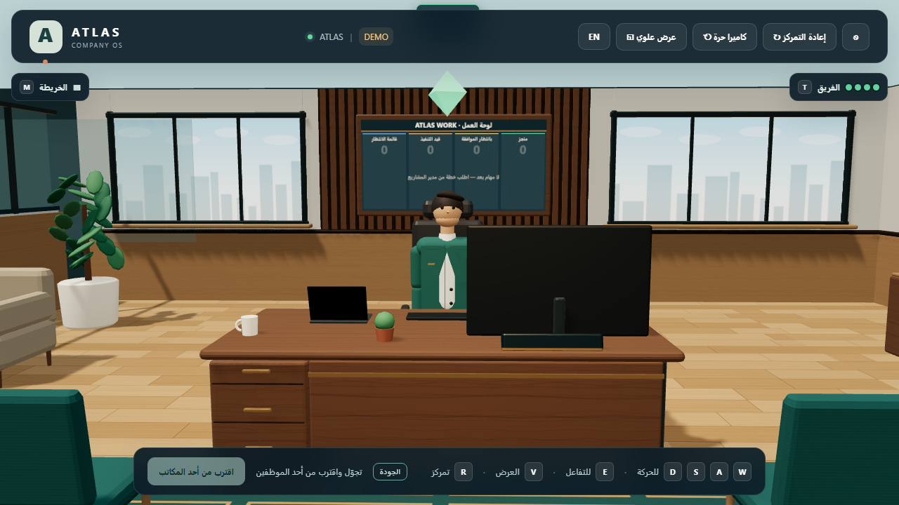

# COS-109 — Project Manager office: art vertical slice

**Status:** implemented on branch `cos-109-pm-office-slice`, awaiting **CEO visual approval** (issue #11, deliverable E).
Nothing else in the office was restyled: per the blueprint, other departments wait for this approval.

## What changed (3D renderer only)
| Area | Before (block-out) | After (slice) |
|---|---|---|
| Floor | flat mint carpet | oak plank floor (procedural texture, staggered planks, per-plank tint), patterned teal/amber rug |
| Walls | flat panels, bare glass | oak wainscot + cap rail, cream upper walls, walnut slat feature wall, two framed windows with sills and a generic daylight skyline, glass partitions with slim mullions |
| Desk | box top + two slabs | walnut executive desk: drawer pedestal with brass pulls, steel legs, modesty panel, monitor with bezel and stand, laptop, keyboard, mouse, notepad + pen, mug, cactus, articulated lamp, bilingual nameplate |
| Seating | box chairs | leather executive chair (5-star base), two upholstered visitor chairs, a new lounge corner (two armchairs + round walnut table) |
| Storage / decor | box cabinet | walnut credenza with books and vase, framed abstract prints, wall clock, ceramic planter with a leafy plant, brass arc floor lamp |
| Wall board | static coloured rectangles | **live ATLAS WORK sprint board**: column counts from the real task list (`pmBoardCounts`), honest empty state ("لا مهام بعد") |
| Manager | low-poly standing figure | detailed humanoid (blazer with lapels, shirt, belt, hands with thumbs, shoes, face, hair), **seated** at the desk; same rig, so every status pose still shows the real status |
| Lighting | global sun + sky | + warm spotlight over the desk, emissive lamp shades, a small in-engine reflection environment on metal / brass / ceramic / leather / walnut |

All geometry and textures are original and procedural (no downloaded assets, no new dependencies). Static meshes
are merged per material: the whole room is **31 meshes, ~18.8k triangles, 28 materials**; the manager is ~6.9k
triangles.

### What did NOT change
- **Colliders, doorways, line of sight, E-to-interact:** world-data still emits every collider; the slice only
  replaces how the tagged primitives (`zone: 'pm'`) are drawn. A unit test checks that every art piece sits on its
  collider (> 55 % overlap, < 0.45 m spill) so what you see is what blocks you. New lounge furniture got new colliders.
- **Canvas2D fallback** (Firefox without WebGL, `?canvas`): unchanged block-out.
- **Status honesty:** the board shows only real counts; the manager's pose still comes from `presence.js`.
- `?art=0` turns the slice off (A/B review and low-end GPUs).

## Concept images
The five ATLAS-Visual-Blueprint concept renders (`01`–`05`) were **not found on this computer** (searched Desktop,
Downloads, Documents). They are not in the repo, so `docs/design/concepts/` was not created. The slice was built
against the written blueprint (`docs/design/ATLAS-VISUAL-BLUEPRINT.md` on PR #13) and the palette/tokens of
`ATLAS-REFERENCE-SHEET.svg`. Comparison with concepts 01 and 04 is still open.

## Matched captures
`node scripts/capture-cos109.mjs <label>` — throwaway DEMO server, fresh database (0 tasks), same player positions
and camera poses. "Before" was captured from a clean checkout of `main` (6bfb5d7) with only the capture-only
`debugView` hook added (no visual change). Eye-level shots use that hook; follow and overview use the game's own
cameras.

| Shot | 1280×720 | 1920×1080 |
|---|---|---|
| Follow camera (in front of the desk) | [before](before-follow-1280x720.png) · [after](after-follow-1280x720.png) | [before](before-follow-1920x1080.png) · [after](after-follow-1920x1080.png) |
| Overview | [before](before-overview-1280x720.png) · [after](after-overview-1280x720.png) | [before](before-overview-1920x1080.png) · [after](after-overview-1920x1080.png) |
| Eye level, doorway | [before](before-eye-door-1280x720.png) · [after](after-eye-door-1280x720.png) | [before](before-eye-door-1920x1080.png) · [after](after-eye-door-1920x1080.png) |
| Eye level, diagonal | [before](before-eye-corner-1280x720.png) · [after](after-eye-corner-1280x720.png) | [before](before-eye-corner-1920x1080.png) · [after](after-eye-corner-1920x1080.png) |

## Performance (honest)
Headless Chromium with **software WebGL (SwiftShader)**, same machine, same poses. Frames per second:

| Shot | 1280×720 before → after | 1920×1080 before → after |
|---|---|---|
| Follow | 15.2 → 8.3 | 8.2 → 3.7 |
| Overview | 19.0 → 12.5 | 11.0 → 6.3 |
| Eye level, doorway | 16.8 → 5.2 | 9.0 → 3.1 |
| Eye level, diagonal | 15.8 → 5.8 | 8.4 → 3.3 |

This is a **real regression on software rendering**: the slice roughly halves the headless frame rate. Profiling
by toggling features showed the cost is pixel shading of the room's large lit surfaces plus the spotlight and
reflections (each ~1–4 fps); geometry is small. Two mitigations are already in (one light instead of three,
reflections only on shiny materials). **A real-GPU figure was not obtained:** the automated Chrome window was
throttled to 1 fps by the browser (background window), so that number is meaningless and is not reported.
Next steps if the CEO approves the look: bake the slice lighting into textures (lightmap), drop the spotlight,
and measure on the CEO's own machine (`?art=0` vs default).

## Tests
- `tests/cos109.test.mjs` (6 unit tests): only PM primitives are tagged; colliders unchanged and still blocking;
  every art piece sits on its collider; room bounds and draw-call/triangle budget; board maps every schema task
  status (except `blocked`/`rejected`, deliberately) and counts real tasks only; the detailed humanoid keeps the
  shared rig, animates every status pose, sits correctly and matches the player's scale.
- Full suite results: see [TEST-RESULTS.md](../TEST-RESULTS.md).

## Known limitations
- Face detail is stylised and simple (procedural primitives); no rigged or licensed character model.
- Only the PM office is upgraded; neighbouring rooms keep the block-out look, so the contrast is visible from the
  overview.
- The board counts tasks but does not list task titles (that is COS-110B, the in-game work board).
- No concept-image comparison yet (images not available locally).

## CEO decision requested
Approve the look of this slice (or list changes) before the same treatment is applied to other departments.
