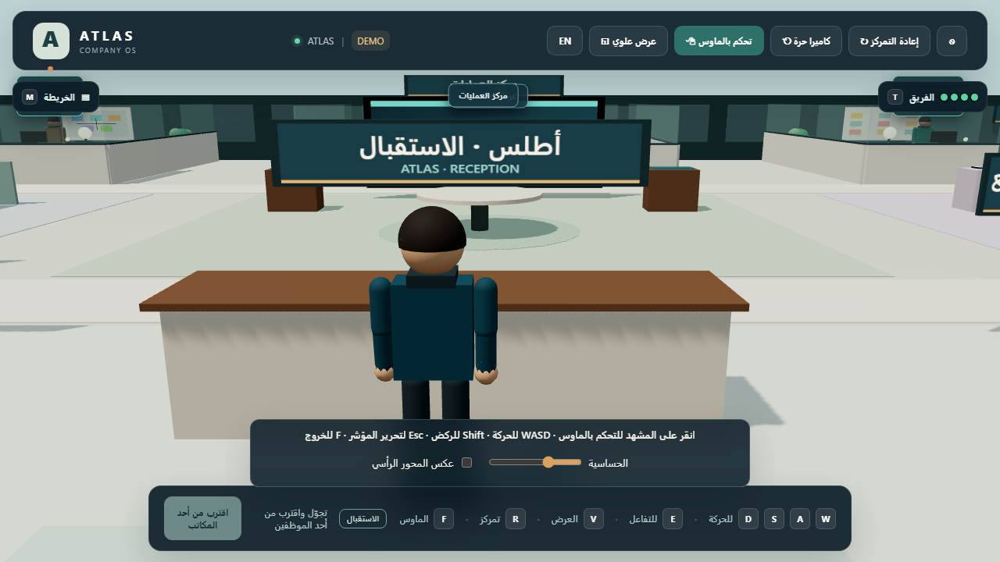

# COS-110A — Opt-in third-person mouse control

**Status:** implemented on branch `cos-110a-third-person` (from `main`, independent of COS-109 / PR #14). Not merged.

## What it is
A third camera mode for walking the office like a third-person game. It is an original implementation, not a copy of any game or asset. The existing follow view, overview, free camera (C), re-centre (R), HUD and touch controls are unchanged, and the default view is still the close follow camera.

| Control | Behaviour |
|---|---|
| **F** or the «تحكم بالماوس / Mouse control» button | Enter / leave third-person mode. On the Canvas2D fallback it is hidden (needs WebGL). |
| **Click the scene** | Captures the mouse (pointer lock). Only an explicit click does this, never automatically. |
| Mouse | Turn (yaw) and look up/down (pitch, clamped −8°…55°). One event is capped so a jump can't spin the view. |
| **WASD** / arrows | Camera-relative: W walks where the camera looks (ground-projected), A/D strafe. The character turns to face its walking direction. |
| **Shift** | Sprint (×1.75). Speed changes are smoothed (acceleration / deceleration). |
| **E** | Interact (unchanged, with line of sight). Opening any panel releases the mouse and stops movement. |
| **Esc** | Releases the mouse (browser behaviour) and closes panels. |
| **V** | Goes to the overview. **R** re-centres behind the character. Wheel / pinch zooms within 2.2–8 m. |
| Without pointer lock | Dragging with the left mouse button also looks around (fallback). |
| Settings | Sensitivity slider (0.2–3) and invert-Y, stored in this browser only (`atlas-look-v1`). |

Third-person mode is never restored on reload, so a page never opens with a captured mouse. The arrow keys and WASD use the physical key, so they also work on Arabic keyboard layouts.

### Camera obstruction
The look target sits at head height with a small over-the-shoulder offset. Each frame, the rig checks the segment from the target to the desired eye against the same sight-blocking colliders that are used for line of sight. If a wall is in the way, the eye is pulled in front of it, quickly on the way in and slowly on the way out. When the camera ends up very close, the avatar fades so it never fills the screen.

### Focus loss
Window blur and pointer-lock loss clear all held keys, so the character never keeps walking. A toast explains how to resume.

## Code
- `public/js/core/third-person.js` (new, pure and unit-tested): `applyMouseLook`, `cameraRelativeDirection`, `segmentEntry`, `unobstructedDistance`, `thirdPersonPose`, `stepThirdPerson`, `THIRD_PERSON` limits.
- `public/js/game/camera-controller.js`:
  - `third` mode, pointer lock on click, drag fallback;
  - `look` target, `lookBy` (the same code path real mouse movement uses; used by the tests);
  - look settings persistence.
- `public/js/main.js`: F / button, hint panel with settings, third-person stepping, panel-opens-releases-mouse, lock-loss handling.
- `public/js/world/renderer-three.js`: uses the camera's look height; fades the avatar when the camera is close.
- `public/js/game/input.js`: Shift tracked as a held key.
- `index.html` / `styles.css` / `i18n.js`: button, hint and settings, in Arabic and English.

## Evidence (headless Chromium, 1280×720, DEMO)
| | |
|---|---|
| [Follow view (unchanged default)](follow-reception.png) | [Third-person at reception](third-reception.png) |
| [After mouse look](third-hint-hidden-look-left.png) | [Corridor](third-corridor-offices.png) |
| [Wall behind the player: eye pulled in, avatar faded](third-wall-behind.png) | |

## Tests
- `tests/cos110a.test.mjs`: 5 unit tests.
  - W equals camera forward for any yaw; D is right.
  - Mouse look direction, invert-Y, pitch clamp, sensitivity scaling and the spike cap.
  - Obstruction keeps the eye inside the room.
  - Acceleration, sprint speed, deceleration, and walls still stop the player.
  - The character faces its walking direction.
- `tests/e2e/cos110a.spec.mjs`: 4 browser tests.
  - Entering and leaving (F, button, V); never restored on reload.
  - Mouse look plus W walks along the camera's forward direction, with the Arabic layout.
  - The camera stays inside the room with a wall behind.
  - Drag-to-look without pointer lock; opening a panel stops movement and frees the mouse.
- Full results: [TEST-RESULTS.md](../TEST-RESULTS.md).

## Known limitations
- **Pointer lock is not covered by automated tests.** It needs a real user gesture. It was not checked manually in a physical browser session either: the CEO should click the scene once in Chrome, Edge and Firefox. The mouse-look maths and code path are tested through `lookBy` and drag.
- **Animation:** no separate run animation clip. Walk cycles speed up with real distance, so sprinting looks like a faster walk.
- **Camera obstruction:** only walls (sight-blocking colliders) are considered. Furniture can sit between the camera and the character.
- **Controls:** not remappable yet. Touch devices keep the existing follow camera and on-screen pad; mouse control is a desktop feature.
- **First-person:** not implemented, which is deliberate.
